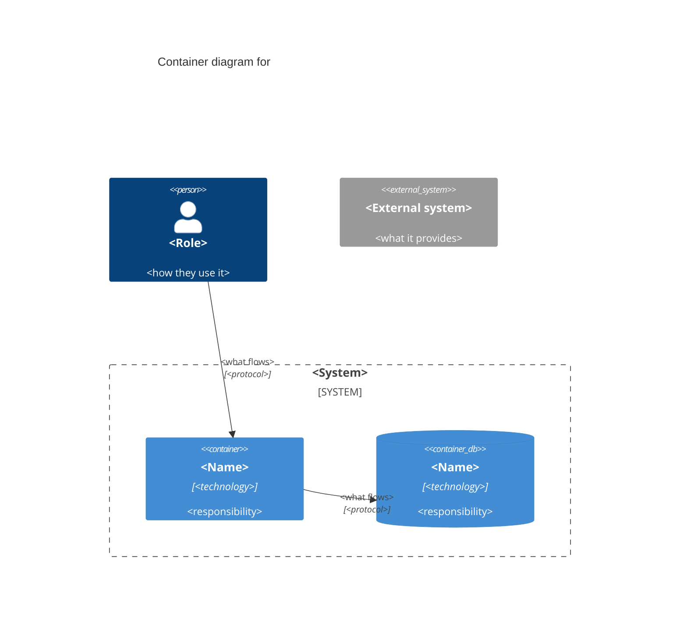

# C4 Level 2 Notation

How a Container diagram is written. Self-contained. Sources: `research/software-architecture/c4-model-brown.md` (abstractions, review checklist, brokers, modular monoliths), `research/software-architecture/building-microservices-newman.md` (smart endpoints, dumb pipes). The deployment view's notation is in `deployment-view.md`.

---

## 1. Elements

The container diagram shows one software system's insides. Five kinds of element:

| Element | What it is | On the diagram |
|---|---|---|
| System boundary | The one system from the context diagram | A labelled frame; everything inside is ours |
| Container | A runnable or deployable unit that runs code or stores data (Brown) | A box inside the frame |
| Person | A role from the context diagram, unchanged | Outside the frame |
| External system | A system from the context diagram, unchanged | Outside the frame |
| Arrow | A runtime interaction | One direction, labelled |

**A container is not a Docker container.** Brown chose the word before Docker; a Docker image, a pod or a replica is how a container is deployed, and belongs to the deployment view.

## 2. Box Anatomy

```
+----------------------------------+
| [Container: API]                 |   type tag
| Appointments API                 |   name, in the product's language
| Go, net/http + chi               |   technology
| Books and moves appointments     |   responsibility, one line
+----------------------------------+
```

| Type tag | Examples |
|---|---|
| `[Container: Web App]` | A server-rendered app or single-page app |
| `[Container: Mobile App]` | An iOS or Android app we ship |
| `[Container: API]` | A synchronous service |
| `[Container: Worker]` | Consumes events or runs jobs |
| `[Container: Application]` | A modular monolith's one deployable (API, pages and jobs in one) |
| `[Container: Database]` | A database or schema we provision |
| `[Container: Broker]` | The message broker we run |
| `[Container: File Store]` | An object or file store we own |
| `[Container: Gateway]` | The north-south entry, if there is one |

**Technology** comes from `sdlc-config.json` and the plugin's defaults (`sdlc-config-management`), spelled as there: Go with net/http and chi; PostgreSQL with pgx; Redpanda; React with TypeScript; Apache AGE for graphs. A label for a technology nobody agreed is an override in disguise: write the ADR first.

**One technology per box.** A box that needs two is usually two containers.

**Modules of a monolith** are not boxes. List them in the catalog's *Contexts* column and, if a reader needs their insides, on a component diagram.

**Observability** (OpenTelemetry, Prometheus, Tempo, Grafana) instruments every container; note it once in the key unless a collector is a real container in the topology.

## 3. Arrows

- **One direction**, from the caller or the publisher. A reply is part of the call; a callback or webhook the other side starts is its own arrow.
- **Label** reads from start to end and says what flows: "Books appointments in", "Publishes `InvoiceIssued` to", "Reads and writes appointment rows in".
- **Protocol** is mandatory at Level 2: HTTPS/JSON, gRPC, SQL, Kafka protocol, SMTP, webhook.
- **Sync or async:** solid for synchronous, dashed for asynchronous, stated in the key.
- Never "uses", "talks to" or a two-headed arrow.

## 4. The Broker

Brown's options, any of which is fine if the reader can still see who depends on whom:
- the broker as one container, each arrow labelled with its topic, plus a **topic table** in the catalog (topic, publisher, consumers);
- each topic as its own box, when there are few;
- no broker box, with arrows from producer to consumer labelled "via topic `x`".

Avoid the hub: every container with an arrow pointing at the broker and nothing else. The producer-consumer pairs are the point.

**Smart endpoints, dumb pipes** (Newman): topics carry events; the broker never routes on content, transforms or decides. The same holds for the gateway and the mesh.

Cross-context topics carry the published event contract only (`event-schema-design`); a context's internal topics are not consumed by others.

## 5. Key

```
Key
  [Container: <type>]   a runnable or deployable unit of <System>
  [Person] / [External System]   from the system context diagram, same names
  ────▶   synchronous call; points from the caller
  - - -▶  asynchronous message; points from the publisher; label names the topic
  Labels say what flows, then [protocol]
  Not shown here: where containers run and how many (see Deployment View)
```

## 6. Consistency With Level 1

- Every person and external system here is on the context diagram with the same name; every one on the context diagram that touches a container is here.
- A new external system found at Level 2 means the context diagram was incomplete: add it there first, and re-present.
- No container here may belong to another team's system; that is an external system.

## 7. Review Checklist (Brown, Applied to Level 2)

| Check | Pass |
|---|---|
| Title | `Container diagram for <System>` |
| Key | Types, line styles, what an arrow means, where deployment detail lives |
| Every box | Type tag, name, technology, responsibility |
| Every arrow | One direction, what flows, protocol, sync or async |
| Broker | Producer-consumer pairs readable |
| Levels | No component, class or deployment detail; persons and external systems match Level 1 |
| Colour | Never the only carrier of meaning |

## 8. Mermaid (Optional, Standard and Enterprise)

A copy of the ASCII, with the same names and arrows; Mermaid's C4 types are still marked experimental.


