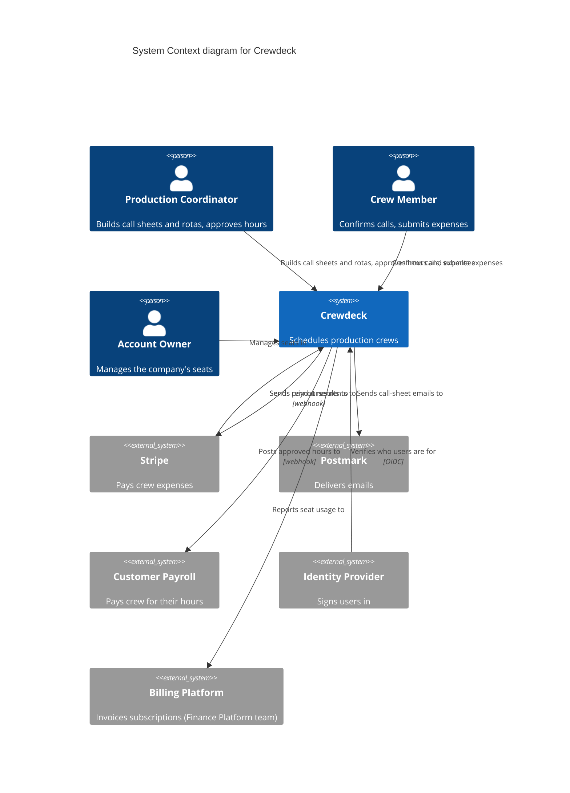

# Example 2 — Standard: A B2B SaaS

Self-contained. **Crewdeck** schedules film and TV production crews: production coordinators build call sheets and crew rotas; crew members confirm calls and submit expenses from the mobile app; each production company's account owner manages its seats. Crewdeck reimburses approved expenses through **Stripe**, signs users in through each customer's own identity provider, sends call-sheet emails through **Postmark**, and posts a webhook to the customer's payroll system when a crew member's hours are approved. Subscriptions are invoiced by the **Billing Platform**, which the company's Finance Platform team builds and runs for all of its products. **Standard** profile.

## Input

> **User:** "Billing Platform is ours, same company, so keep it inside Crewdeck. The mobile app is a separate thing crew download, so give it its own system box. Payroll and Stripe both send things back, so one two-headed arrow each is fine. And add a Mermaid version, it renders in our wiki."

## Working it

- **Billing Platform:** another team owns and runs it, on its own release schedule; Crewdeck depends on its contract and its outages. Under Brown's ownership rule it is its own software system: **external**, with the Finance Platform team named as owner. Declined, with that reason.
- **The mobile app:** we build and ship it; it is a **container** of Crewdeck, alongside the web app and the API. The person is the **Crew Member**, who uses Crewdeck through it. Declined, with the reason; the rationale names the app.
- **Two-headed arrows:** declined. Each direction is its own arrow with its own label: Crewdeck sends reimbursements to Stripe; Stripe sends payout results back. The payroll system only receives; one arrow.
- **Identity provider:** the customer's own (Okta or Entra ID, depending on the customer): one external system, customer-owned.
- **Mermaid:** standard allows a copy when asked; it uses `C4Context`, and the ASCII stays the reviewed version.

## Output: `artifacts/crewdeck/design/architecture/system-context.md`

````markdown
---
name: system-context-diagram
product: crewdeck
version: 1.0.0
phase: design
owner: enterprise-architect
created: 2026-04-02
summary: Crewdeck as one system for coordinators, crew and account owners, working with the customer's IdP and payroll, Stripe, Postmark and the Finance Platform team's Billing Platform.
traces-to: [ideate/user-personas.md, design/event-storming/big-picture.md, design/context-map.md, ideate/nfr-specification.md]
---

# System Context diagram for Crewdeck

**Readers:** the product owner, customers' IT and security reviewers, new team members
**Question it answers:** what Crewdeck is, who uses it, and which other systems it works with.

## Diagram

```
 ┌────────────────────────┐                   ┌────────────────────────┐                   ┌────────────────────────┐
 │ [Person]               │                   │ [Person]               │                   │ [Person]               │
 │ Production Coordinator │                   │ Crew Member            │                   │ Account Owner          │
 │ Builds call sheets and │                   │ Confirms calls and     │                   │ Manages the production │
 │ rotas                  │                   │ submits expenses       │                   │ company's seats        │
 └────────────┬───────────┘                   └────────────┬───────────┘                   └────────────┬───────────┘
              │ Builds call sheets,                        │ Confirms calls,                            │ Manages seats in
              │ approves hours                             │ submits expenses                           │
              ▼                                            ▼                                            ▼
 ┌────────────┴────────────────────────────────────────────┴────────────────────────────────────────────┴─────────────┐
 │ [Software System]                                                                                                  │
 │ Crewdeck                                                                                                           │
 │ Schedules production crews: call sheets, rotas, confirmations, hours and expenses                                  │
 └─┬────────────▲─────────────────┬───────────────────────┬───────────────────────▲───────────────────────┬───────────┘
   │ Sends      │ Sends           │ Sends call-           │ Posts                 │ Verifies              │ Reports
   │ reimburse- │ payout          │ sheet emails          │ approved              │ who users             │ seat usage
   │ ments to   │ results to      │ to                    │ hours to              │ are for               │ to
   ▼            │                 ▼                       ▼                       │                       ▼
 ┌──────────────┴─────┐  ┌────────────────────┐  ┌────────────────────┐  ┌────────┴───────────┐  ┌────────────────────┐
 │ [External System]  │  │ [External System]  │  │ [External System]  │  │ [External System]  │  │ [External System]  │
 │ Stripe             │  │ Postmark           │  │ Customer Payroll   │  │ Identity Provider  │  │ Billing Platform   │
 │ Pays crew expenses │  │ Delivers emails    │  │ Pays crew for      │  │ (customer's own)   │  │ Invoices           │
 │                    │  │                    │  │ their hours        │  │ Signs users in     │  │ subscriptions      │
 └────────────────────┘  └────────────────────┘  └────────────────────┘  └────────────────────┘  └────────────────────┘
```

## Key

- `[Person]` a role that uses the system
- `[Software System]` the system being built (one box)
- `[External System]` a system someone else owns and runs
- Arrows point from the party that starts the exchange (`▼` down from the starter, `▲` up into Crewdeck); the label says what flows.

## Element Catalog

### System

**Crewdeck:** Schedules film and TV production crews: call sheets, rotas, call confirmations, approved hours and expense reimbursements.

### Persons

| Person | Role | How they use the system | Source |
|---|---|---|---|
| Production Coordinator | Runs a production's crew logistics | Builds call sheets and rotas, approves hours and expenses | persona: Production Coordinator |
| Crew Member | Freelance crew on a production | Confirms calls, submits expenses (through the mobile app) | persona: Crew Member |
| Account Owner | The production company's admin | Manages the company's seats and settings | persona: Account Owner |

### External Systems

| System | Owner | Kind | Provides or receives | Source |
|---|---|---|---|---|
| Stripe | Stripe | third-party service | Receives reimbursement payouts; sends payout results | Context Map: Payouts ACL |
| Postmark | Postmark | third-party service | Receives call-sheet emails to deliver | story: call sheet sent to crew |
| Customer Payroll | Each production company | customer-owned | Receives approved hours by webhook | Event Storming: Hours Approved |
| Identity Provider | Each production company (Okta or Entra ID) | customer-owned | Verifies who users are at sign-in | NFR: single sign-on per customer |
| Billing Platform | Finance Platform team, our company | another team in our organisation | Receives seat usage; invoices subscriptions | Context Map: Billing (Customer-Supplier) |

### Relationships

| From | To | What flows | Protocol |
|---|---|---|---|
| Production Coordinator | Crewdeck | Builds call sheets and rotas, approves hours and expenses | HTTPS |
| Crew Member | Crewdeck | Confirms calls, submits expenses | HTTPS |
| Account Owner | Crewdeck | Manages seats in | HTTPS |
| Crewdeck | Stripe | Sends reimbursements to | HTTPS |
| Stripe | Crewdeck | Sends payout results to | webhook |
| Crewdeck | Postmark | Sends call-sheet emails to | HTTPS |
| Crewdeck | Customer Payroll | Posts approved hours to | webhook |
| Identity Provider | Crewdeck | Verifies who users are for | OIDC |
| Crewdeck | Billing Platform | Reports seat usage to | HTTPS |

## Rationale

The web app, the mobile app, the API and its database are containers of Crewdeck, drawn on the container diagram. Billing Platform is external because the Finance Platform team owns and runs it on its own schedule; Crewdeck depends on its contract, not its code. Payroll and the identity provider are each customer's own, so they are external and customer-owned.

## Boundary Notes

- **Constraints:** each customer brings its own identity provider; Crewdeck never stores passwords. Payroll data stays in the customer's payroll system.
- **Out of scope:** calculating pay (the customer's payroll does); invoicing subscriptions (Billing Platform does); card collection from production companies (Billing Platform).

## Open Questions

- none

## Mermaid (copy of the ASCII)


````

## Why this is right

- Billing Platform is external on the ownership rule, with its owning team named; the user's "same company" argument was answered, not followed.
- The mobile app is a container named in the rationale; the Crew Member is the person.
- Every two-way exchange is two labelled arrows; the key says what an arrow means.
- The Mermaid copy uses `C4Context` with the same names and arrows; the ASCII is the reviewed version.
- `validate-system-context.sh` exits clean on the artifact.
