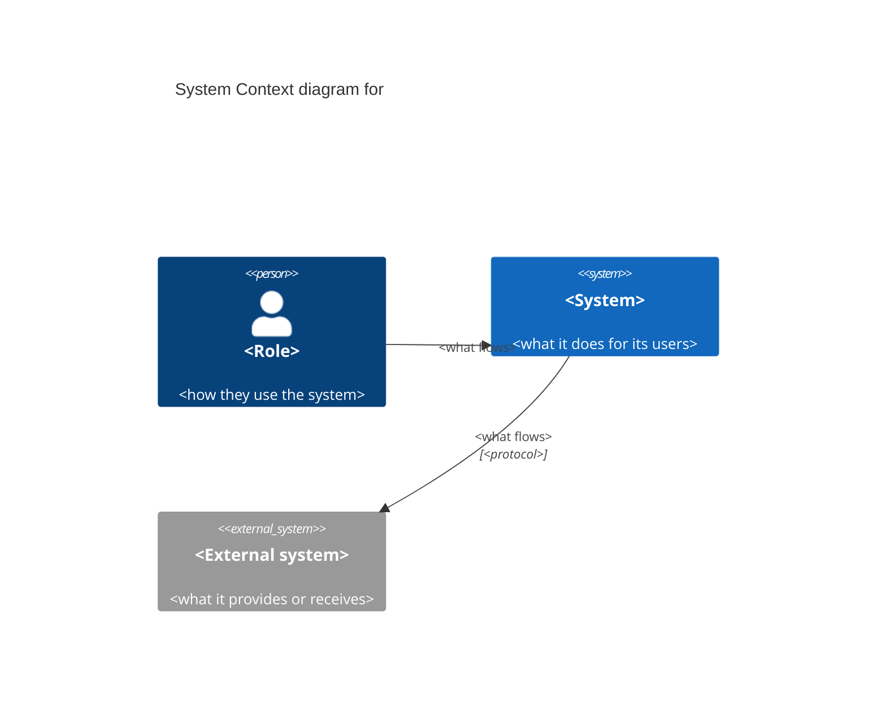

# C4 Level 1 Notation

What a System Context diagram may contain and how each part is written. Self-contained. Sources: `research/software-architecture/c4-model-brown.md` (the C4 abstractions, the levels, the review checklist), `research/software-architecture/documenting-software-architectures-clements.md` (views, documentation packages). Where a rule is this plugin's own choice rather than Brown's, it says so.

---

## 1. Where Level 1 Sits

C4 fixes a small set of abstractions first and lets any notation show them (Brown: teams draw confusing diagrams for lack of shared abstractions, not lack of notation).

| Abstraction | What it is |
|---|---|
| Person | A human user or role, a type of user, never a named individual |
| Software system | Something that delivers value to its users, owned and built by one team or organisation. The system being described and the external systems it talks to are both software systems |
| Container | A separately runnable or deployable unit inside a software system that runs code or stores data: a web app, a single-page app, a mobile app, an API, a database schema, a file store, a serverless function, a batch job. **Not a Docker container** |
| Component | A grouping of functionality behind an interface inside one container |
| Code | The classes, functions and tables that implement a component |

The four core diagrams zoom through that hierarchy:

| Level | Diagram | Scope | Reader |
|---|---|---|---|
| 1 | System Context | One software system | Everyone, technical or not |
| 2 | Container | One software system | Technical readers |
| 3 | Component | One container | Engineers changing it |
| 4 | Code | One component | Rarely drawn by hand |

Level 1 shows only persons and software systems. A container, component or piece of code on this diagram is a mixed level, the most common C4 mistake.

**Beside the views tradition.** Brown describes C4 as a simplification of the views literature (Kruchten's 4+1 and others) for developers. Clements' viewtypes are a useful lens on it, not its origin: read this way, the System Context diagram is a component-and-connector view at its coarsest grain (one component, the system; its neighbours; labelled connectors). That is why it has no time order (a numbered flow is a Dynamic diagram) and no code structure (a module view).

## 2. Elements

Each element carries its **type in text**, its **name** and a **short description** (Brown).

**The system** — exactly one box.
- Name: the product's own name in its Ubiquitous Language.
- Description: one sentence on what it does for its users ("Books sewing classes and machine time for one studio"), never how it is built.
- Two boxes for the system being built means the boundary has split: merge them, or you are drawing Level 2.

**Person** — one per role.
- Name: the role from the personas and the Event Storming actors (`Coordinator`, `Grower`), never "User".
- Description: how this role uses the system.
- External people in other organisations are persons too (a supplier's dispatcher who logs in), described with their organisation.

**External system** — one per system someone else owns and runs.
- Name: the name its owner uses (`Stripe`, `Okta`, `the national grain-quality register`); for a customer-owned system, say so (`the customer's payroll system`).
- Description: what it provides to, or receives from, the system.
- Catalog columns: owner; kind (third-party service, partner organisation, customer-owned, another team in our organisation, regulator); what it provides or receives.

**Nothing else.** Databases, brokers, caches, gateways, load balancers, clusters, the cloud provider, the CDN and observability tools are containers or infrastructure: the container diagram and its deployment section (D047-13).

## 3. Relationships

Brown's rules, with the plugin's default meaning:
- **One direction per arrow, with a label that reads in that direction** ("Sends payment requests to", "Books a class in"). A two-headed arrow hides which way things flow; draw two arrows.
- **Say what a line means** and keep it consistent: dependency, data flow or initiation. The plugin's default for Level 1 and Level 2: **the arrow points from the party that starts the exchange**. A pushed alert points from the system to the person; a person opening a dashboard points from the person to the system. State the meaning in the key, so a different meaning at Level 3 (source-code dependency) is visible to the reader.
- **No vague labels:** "uses", "integrates with", "talks to", "interacts with" and "calls" say nothing about what flows.
- **Protocol optional, plain:** "HTTPS", "OIDC", "webhook", "SFTP file drop", "email". Never a library or framework.
- **Only arrows that touch the system box.** How two external systems talk to each other is not this system's concern.

## 4. Title and Key

Brown's review checklist, applied to Level 1:

| Check | Pass |
|---|---|
| Title | States the diagram type and scope: `System Context diagram for <System>` |
| Key | Explains every element tag, line style and arrowhead, and what an arrow means, even when it seems obvious |
| Element type | Every box states its type in text |
| Description | Every box has a short description of its responsibility |
| Arrows | Every arrow is one-directional with a label that matches its direction |
| Acronyms | None unexplained |
| Colour | Never the only carrier of meaning |

A key for the ASCII form:

```
Key
  [Person]           a role that uses the system
  [Software System]  the system being built (one box)
  [External System]  a system someone else owns and runs
  ──▶               the arrow points from the party that starts the exchange;
                     the label says what flows
```

**Colour is a house choice, not C4.** If a rendered copy uses colour (the plugin's usual choice: blue for the system, a light shade for persons, grey for external systems), the type tag in text still carries the meaning.

## 5. Notation (D047-13)

One rule for all three C4 skills (`system-context-diagram`, `container-diagram`, `component-diagram`): **ASCII primary, with the element catalog tables; Mermaid optional.** C4 prescribes abstractions and discipline, not a format, so a plain-text picture plus tables satisfies it (Brown), and the product owner can review it without tooling.

ASCII conventions:
- Fenced code block; box-drawing characters or `+--+`, whichever is consistent.
- Each element's name on one line of its box; type tag on the first line.
- The system box in the middle, persons above, external systems at the sides or below. Arrowheads `▶ ◀ ▲ ▼` (or `> < ^ v`), never on both ends of one line.
- Wrap descriptions inside boxes; put long text in the catalog instead.

Mermaid, when wanted (standard and enterprise only):
- Prefer Mermaid's `C4Context` type to `flowchart`; it carries the C4 types. It is still marked experimental in Mermaid, so the ASCII stays the reviewed artifact.
- It is a copy of the ASCII: same elements, same names, same arrows.



Structurizr DSL (open source) defines each element once and renders every level from one model, so names cannot drift; it is an option for teams that want it, never a requirement.

## 6. Optional C4 Extras

Drawn only when a named reader needs one (Fairbanks: a model answers a named question):
- **System Landscape:** like a context diagram with no single focus, showing all of an organisation's systems and people. Useful in an enterprise with many systems; it does not replace this view.
- **Dynamic:** a numbered runtime flow for one story or saga, at container or component level. A request to "number the arrows" on this view is a request for a Dynamic diagram.
- **Deployment:** containers on infrastructure in one environment. In this plugin it is a section of the container diagram (D047-13), never this view.

## 7. The Documentation Package

Clements: a diagram on its own is "just a picture", reviewable by eye but not a specification. The Level 1 view carries:
- **Primary presentation:** the ASCII diagram with title and key.
- **Element catalog:** a table each for the system, persons, external systems and relationships, with the properties the boxes can't carry (owner, kind, protocol).
- **Rationale:** why this boundary and these external systems. It explains the view's shape; a cross-cutting decision is an ADR (`adr-authoring`).
- **Boundary notes:** the constraints that force the boundary (data residency, a regulator, a contract, an existing system that stays) and what is out of scope.
