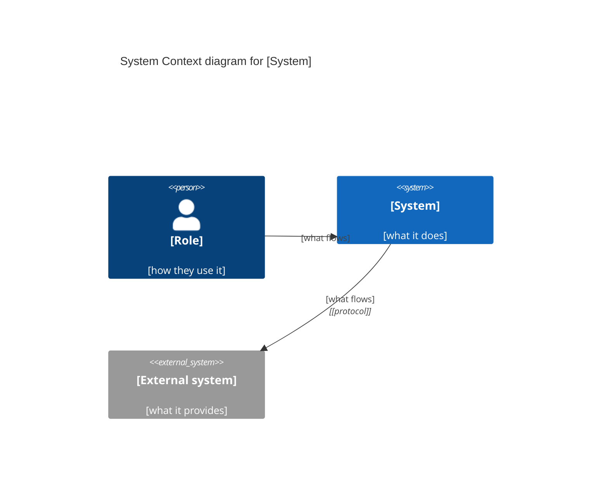

# System Context diagram for [System]

<!-- Path: artifacts/<product>/design/architecture/system-context.md. One per product, every profile.
     Lean: the diagram, key and catalog; one or two sentences each for Rationale and Boundary Notes; no Mermaid. -->

**Readers:** [the product owner and who they show it to: executives, partners, a regulator, new team members]
**Question it answers:** what [System] is, who uses it, and which other systems it works with.

## Diagram

```
[ASCII diagram. One [Software System] box in the middle; [Person] boxes above; [External System] boxes at the sides or below.
 Each element: type tag on the first line, name on one line, a short description.
 Every arrow touches the system box, points one way, and carries a label saying what flows.]
```

## Key

- `[Person]` a role that uses the system
- `[Software System]` the system being built (one box)
- `[External System]` a system someone else owns and runs
- Arrows point from the party that starts the exchange; the label says what flows.

## Element Catalog

### System

**[System]:** [one sentence: what it does for its users, never how it is built]

### Persons

| Person | Role | How they use the system | Source |
|---|---|---|---|
| [role name, never "User"] | [who they are] | [what they do with it] | [persona / Event Storming actor / story — or *assumed*] |

### External Systems

| System | Owner | Kind | Provides or receives | Source |
|---|---|---|---|---|
| [name its owner uses] | [organisation or team] | [third-party service / partner organisation / customer-owned / another team in our organisation / regulator] | [what it gives or takes] | [Event Storming / Context Map / NFR / story — or *assumed*] |

### Relationships

| From | To | What flows | Protocol |
|---|---|---|---|
| [person or system] | [System] | [a phrase that reads from start to end: "Sends … to", "Books … in"; never "uses" or a bare noun] | [plain protocol or —] |

## Rationale

[Why this boundary and these external systems: which candidates stayed inside as containers (named, deferred to the container diagram), which are external and why (who owns and runs them).]

## Boundary Notes

- **Constraints:** [data residency, a regulator, a contract, a system that must stay — or none]
- **Out of scope:** [what a reader might expect this system to do that another system does]

## Open Questions

- [an assumed element or an unclear owner — who answers it | none]

<!-- Optional, standard and enterprise only, when the user wants a rendered copy. Same elements, names and arrows as the ASCII.
## Mermaid (copy of the ASCII)


-->
